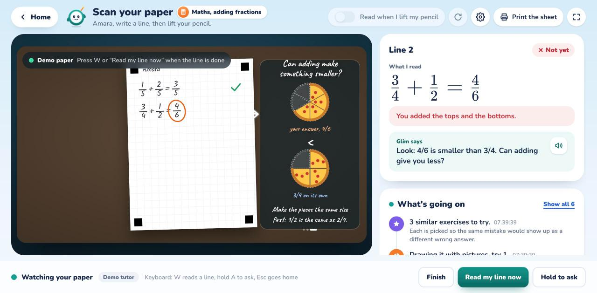
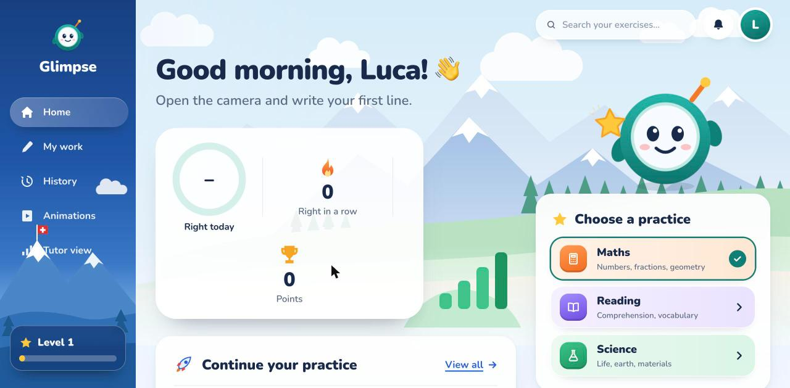
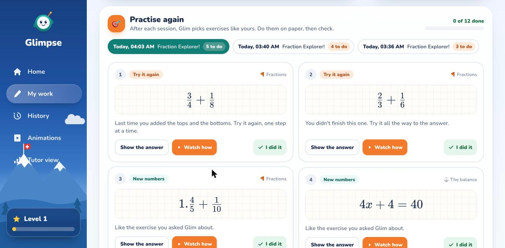
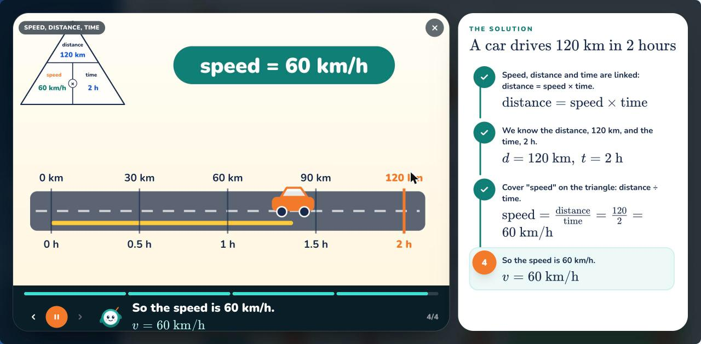
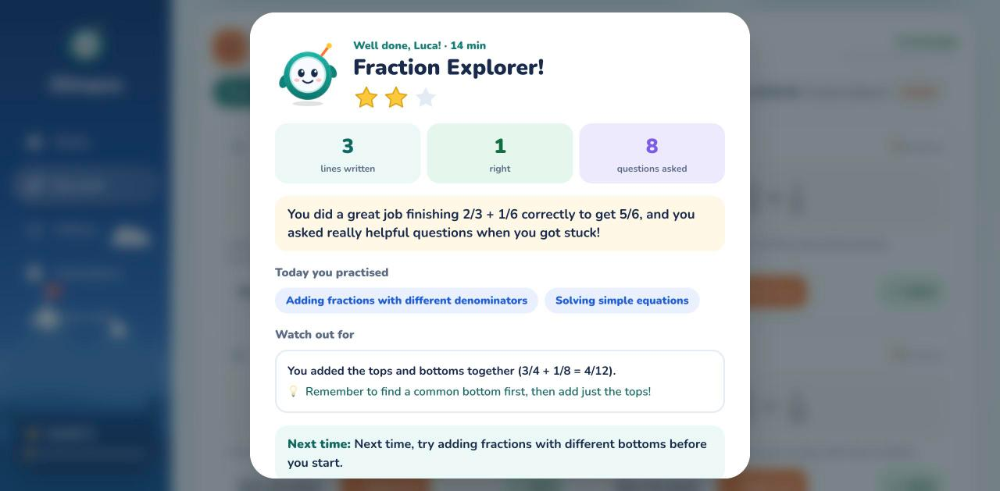
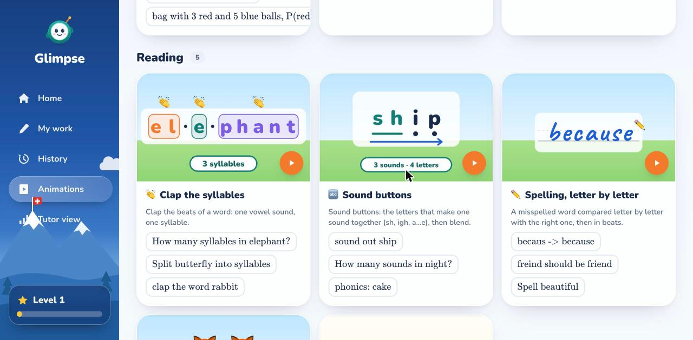
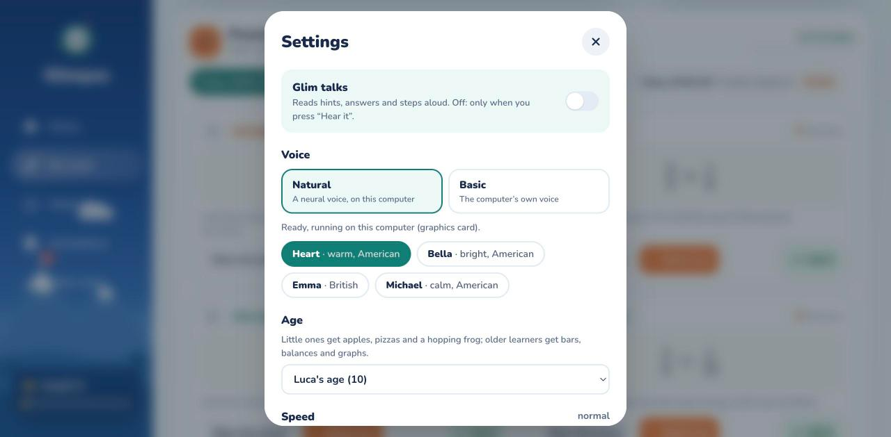

# Glimpse

**A webcam tutor for maths, reading and science.** A child, or an older student, writes on paper under the camera. Glimpse:
- reads what's written, checks it and gives a hint for the next step;
- explains it out loud with a natural voice, using an animation chosen for the exercise and the student's age;
- answers questions the student asks by pointing at the paper;
- suggests exercises to practise after each session.

It runs on your own computer with free, open models, or with cloud models through OpenRouter.

LauzHack 2026, for the Logitech, AXA, IMC and Scholé challenges.



- [What it does](#what-it-does)
- [Run it on your computer](#run-it-on-your-computer)
- [How to use it](#how-to-use-it)
- [Put it online](#put-it-online)
- [Test it](#test-it)
- [What's in the repo](#whats-in-the-repo)
- [Models and fine-tuning](#models-and-fine-tuning)
- [Documentation](docs/README.md)

## What it does

- **Reads the paper, when you choose.** When you stop writing, Glim asks **"Done writing?"**: **Check my line** reads the whole camera photo (GLM-OCR) and checks the line you just wrote; **Check the whole sheet** judges every exercise on the page and reports how many are right, how many to fix and how many aren't finished, with *Show me how* for each one. Nothing is read by itself.
- **Teaches, not just marks.** A concrete hint for the next step. When a line is wrong or unfinished, the full solution is prepared step by step, together with one of **36 animations**:
  - **maths (25):** from counting apples and fraction pizzas to balances, parabolas, limits, integrals and probability trees;
  - **reading (5):** clapping syllables, sound buttons, spelling letter by letter, plurals, fixing a sentence;
  - **science (6):** the unit ladder, speed-distance-time with a car on the road, float or sink, electric circuits, solid-liquid-gas particles, food chains.

  Pick the subject on Home (*Choose a practice*). Every number in an animation is computed by code, never guessed by a model. A small decision model, **Laya**, picks the right animation in about 50 ms.
- **Fits the student.** Pizzas and cookies for a 6-year-old, bars and grids around 10, clean graphs from 13. The teaching style that works for a child (pictures, bars or a worked example) is remembered.
- **Point and ask.** Point at an exercise, hold still, and ask out loud ("how do I solve this?"). Whisper hears the question in the browser; the answer is spoken and the solution opens.
- **Talks naturally.** Kokoro, a natural voice, runs in the browser. It can be turned off, or switched to the system voice.
- **Remembers, subject by subject.** *My work* and *History* keep every line (with its photo), question, solution and animation, the topics practised and the mistakes to watch out for, with tabs for **Maths · Reading · Science · All**. Every session ends with a summary and **Practise again**: 3 to 5 exercises like the day's, with answers worked out by code.
- **For grown-ups.** A tutor view per student: what was practised, what's solid, what needs work, which teaching works.

| Home | My work and Practise again | An animation, full screen |
|---|---|---|
|  |  |  |
| **The summary at the end** | **Every animation** | **Settings** |
|  |  |  |

## Run it on your computer

### What you need

| | Needed for | Get it |
|---|---|---|
| **Node.js 20 or newer** | everything | https://nodejs.org, or `brew install node` |
| **A webcam** (any; we used a Logitech MX Brio) and a sheet of paper | reading | |
| **Ollama** | the models on your computer (free, private) | https://ollama.com/download (`./setup.sh` can install it on a Mac) |
| *or* **an OpenRouter key** | the models in the cloud (no download, pay per use) | https://openrouter.ai/keys |
| **Python 3.10+** | Laya, the animation decision model (optional) | https://python.org, or `brew install python` |
| **Chrome or Edge** | WebGPU for the voice and speech recognition (Safari and Firefox work, more slowly) | |

Disk space: about 9 GB for the local models, plus about 1 GB for Laya. A Mac with Apple Silicon and 16 GB of memory runs everything comfortably.

### 1. Get the code

```bash
git clone https://github.com/xuyaooo/glimpse.git
cd glimpse
```

### 2. Set everything up: one script

```bash
./setup.sh
```

It asks where the models should run, then does everything else:

| Choice | Command | What happens |
|---|---|---|
| **On this computer** (default) | `./setup.sh --local` | installs the packages, checks Ollama (starts it if needed) and downloads `glm-ocr` (reads the paper) and `qwen3.5` (the tutor) |
| **In the cloud** | `./setup.sh --openrouter` | asks for your OpenRouter key (hidden as you paste, checked with OpenRouter, saved only in `.env.local`), and uses `qwen/qwen3.8-flash` to read and `anthropic/claude-haiku-5.5` as the tutor |
| **Both** | `./setup.sh --hybrid` | reads on this computer (`glm-ocr`), with the tutor in the cloud |

In every mode it also installs Laya in `decide/.venv` (skip with `--no-laya`; the engine's rules then pick the animations).

You can run it again any time: it only does what's missing, and it switches mode without forgetting your key. Other options: `--yes` asks nothing, `--test` runs the unit tests at the end. Pick other cloud models by their OpenRouter id: `OCR_MODEL=google/gemini-3.8-flash TUTOR_MODEL=openai/gpt-6-luna ./setup.sh --openrouter`.

<details>
<summary>Or set it up by hand</summary>

```bash
ollama pull glm-ocr && ollama pull qwen3.5   # the models (or put cloud settings in .env.local, see .env.example)
npm run setup                                # the engine's and the app's packages
npm run setup:decide                         # Laya, optional (Python 3.10+)
```
</details>

### 3. Start it

```bash
npm run dev
```

Then open **http://localhost:5173**. That starts three things:

| What | Where | |
|---|---|---|
| the app | http://localhost:5173 | what you open |
| the engine | http://127.0.0.1:3001 | reads, checks, teaches, saves; restarts by itself when you change its code |
| Laya | http://127.0.0.1:8091 | picks the animation; loads in about 15 s |

On the first visit, allow the camera and the microphone. The natural voice and Whisper download into the browser once (a minute or two), then they're cached. Your sessions are saved in `data/` (a local Postgres, PGlite).

### Troubleshooting

| You see | Do this |
|---|---|
| a "Demo tutor" badge, or scripted answers | the app didn't find the engine: is `npm run dev` running? `curl http://127.0.0.1:3001/api/engine/hello` should answer |
| "I couldn't read your paper just now" or "I'm having trouble thinking right now" | Ollama isn't running (`ollama serve`, or open the Ollama app), or a model is missing (`./setup.sh --local`). With OpenRouter: check the key and your credits |
| the first answer takes 20–60 s | the local models are loading into memory; the next ones are much faster. Cloud models answer in a few seconds |
| no camera picture | allow the camera for localhost in the browser's site settings; close other apps using it; pick it in the camera menu at the top |
| Glim doesn't hear you | allow the microphone; hold *Hold to talk* while speaking, or type the question in the box |
| no voice | Settings (the gear) → *Glim talks* on; try *Basic* voice if the natural one is slow on your computer |
| port 3001, 5173 or 8091 already used | another copy is still running: stop it (or the other program), then `npm run dev` again |
| start again from an empty history | stop `npm run dev`, delete `data/pglite` |

## How to use it

1. **Pick your name** (Amara, Luca, Selin, Noor) and press **Continue** to open the camera. The camera should look down at the sheet of paper. *Print the sheet* gives a worksheet whose lines sit where the camera expects them, but any paper works.
2. **Write one line**, for example `3x + 5 = 20` or `3/4 + 1/8 = 4/12`, and stop writing: Glim asks **"Done writing?"**. Press **Check my line** (or *Read my line now*, keys `W`, `C` or `Space`). On the right: what Glim read, whether it's right, and a hint.
   - Finished several exercises? **Check the whole sheet** (in the popup or the bottom bar; when nobody has written for a few seconds the button glows to remind you). The right panel switches to its **Whole sheet** tab: a score ring, the counts of right / to fix / not finished, Glim's sentence, filters, and every exercise with *Show me how* (its worked solution and animation) and *See it* (back to the **This line** tab).
   - The switch *Ask to scan when I stop writing* turns the popup off: then you check with the buttons.
3. **Watch the solution.** When a line is wrong or unfinished, an animation is offered on the camera. Press play: Glim tells each step and the solution on the right lights up with it. Use pause, next and previous, or *Watch it big* to see it full screen next to the written steps. It never starts by itself.
4. **Point and ask.** Point at an exercise with your finger, hold still for a second, and ask your question out loud. You can also hold `A`, or type in the box under the camera.
5. **Finish.** The summary: stars, what you practised, mistakes to watch out for with a tip, and **To practise next time**.
6. **My work** (sidebar), with tabs to keep **Maths, Reading and Science** apart:
   - every line you ever wrote, with its photo, its animation and why it's right or not;
   - your progress and topics;
   - **Practise again**: per session, try each exercise on paper, then *Show the answer*, *Watch how* and *I did it*.
7. **Animations** (sidebar): all 36, by school level and subject, with examples to play.
8. **Settings** (the gear):
   - Glim's voice on or off, natural or basic, which voice, the speed;
   - listening after pointing;
   - the student's age, which sets the animations' look.
9. **Tutor view** (sidebar): for a teacher or parent, a summary per student.

Keys on the camera page: `W` / `C` / `Space` read the line, hold `A` to ask, `Esc` goes home. In the full-screen player: `←` `→` steps, `Space` pauses, `Esc` closes. A scripted demo runs without any model: http://localhost:5173/?demo. Press `W` for the next line.

## Put it online

The app and the engine deploy together on Vercel's free plan:

1. Import this repo in Vercel; `vercel.json` sets the build.
2. Add **Neon** (Storage → Marketplace) for the database.
3. Set the cloud model variables:
   ```
   AI_BASE_URL = https://openrouter.ai/api/v1
   AI_API_KEY = <your key>
   OCR_MODEL = qwen/qwen3.8-flash
   TUTOR_MODEL = anthropic/claude-haiku-5.5
   AI_THINK_OFF = {"reasoning":{"enabled":false}}
   ```
4. Deploy.

Online there's no Laya: the rules pick the animations. **There is no login**: anyone with the URL can read every student's history, so turn on Vercel's Deployment Protection before using real children's data. Details: [docs/deployment.md](docs/deployment.md).

## Test it

```bash
npm test               # 220+ unit tests
npm run sweep          # every animation on 52 edge cases
npm run e2e            # the whole pipeline on real photos (with npm run dev running)
npm run e2e:failures   # what the student sees when a model or the network fails
```

More, and a manual test script: [docs/testing.md](docs/testing.md).

## What's in the repo

| Folder | What |
|---|---|
| `web/` | the app: Vue 3, TypeScript, Tailwind CSS, Vite, KaTeX. Hand tracking (MediaPipe), speech recognition (Whisper) and the voice (Kokoro) run in the browser. The animations are in `web/src/components/scenes/`. |
| `server/` | the engine (Node, Express): reading, checking, teaching, the animations' maths, the suggestions, the database. Locally on :3001, or one Vercel Function (`api/index.js`). |
| `decide/` | Laya, the decision model service that picks the animation (Python, :8091). |
| `models/` | what we tuned, and the tools to specialise Laya, GLM-OCR and Qwen |
| `docs/` | how it works, the animations, settings, testing, deployment, the API, research |
| `test/`, `scripts/` | unit tests, end-to-end tests on real photos, benchmarks |
| `engine/` | the first Python prototype (fractions), kept for reference |
| `setup.sh` | the setup script |

How the pieces fit: [docs/architecture.md](docs/architecture.md).

## Models and fine-tuning

| Job | Model | Local | Cloud (OpenRouter) |
|---|---|---|---|
| read the paper | GLM-OCR (0.9B) | Ollama `glm-ocr` | `qwen/qwen3.8-flash` |
| the tutor | Qwen3.5-9B | Ollama `qwen3.5` | `anthropic/claude-haiku-5.5` |
| pick the animation (37 kinds) | Laya (421M) | `decide/` | (rules) |
| hear the question | Whisper base.en | in the browser | |
| the voice | Kokoro-82M | in the browser | |

[models/](models/README.md) explains what we tuned: Laya learns from about 2,900 generated examples, with tuned decision settings, and **a trained classification head** that beats the example vote (56/57 vs 54/57 on maths, 24/26 vs 22/26 on edge cases, 20/20 on reading and science). [`models/train_small_models.ipynb`](models/train_small_models.ipynb) runs it all in order: packages, data, training, evaluation, for Laya and GLM-OCR. It also holds ready-to-run tools to specialise each model on real children's work:
- **GLM-OCR:** a dataset from the saved camera frames, a review tool and LoRA training;
- **Qwen:** a dataset from saved sessions and MLX LoRA training, then into Ollama.

The research behind the model choices is in [docs/research/](docs/research/).

## Design

The look follows the team's reference images: a sunny Swiss study desk. The design tokens live in `web/src/style.css`.
- Sky background with drifting clouds, the Alps behind the greeting, a deep-blue sidebar ending in mountains with the child's level, and white cards. Glim, the lens mascot, blinks and waves.
- Lagoon teal `#0F7F76` for actions, navy `#18294A` for text, sunflower for stars and sticky notes. Right and not-yet always come with an icon and a word, never colour alone.
- Nunito for the interface. Caveat is the tutor's marker on the whiteboard, Kalam the child's pencil. KaTeX typesets the maths.
- Motion: cards rise in, the scan beam sweeps the line being read, verdicts pop, and right answers get confetti. It all switches off with reduced motion.
